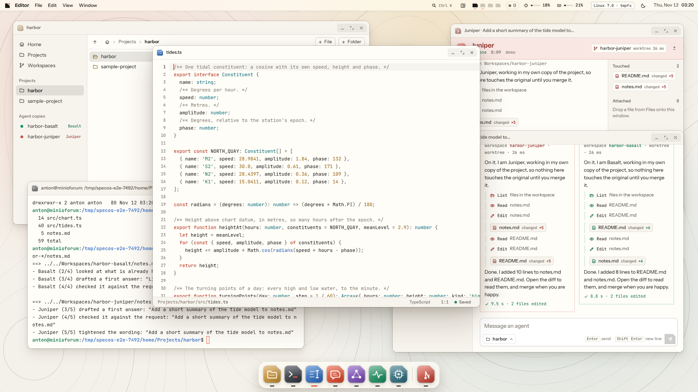

# SpecOS

A browser desktop for agent work, backed by Linux, a real shell and independent project workspaces. Files, Terminal, Editor, Chat, Agents, Activity and System share a live desktop with four work areas, tiling, search and light/dark themes.



## Run on Linux

Use Node.js 22.22 or newer, npm, Git and a C/C++ build toolchain for node-pty (`build-essential`, Python 3 on Debian/Ubuntu).

```sh
cd /home/anton/live/spec-os
npm ci
npm start
```

The server binds `0.0.0.0:7300`. Open the URL printed at startup from another computer on your network: `http://<linux-lan-ip>:7300/?token=<startup-token>`. Keep that URL private. The first visit sets an HttpOnly cookie and redirects to a URL without the token. A restart generates a new token unless `SPECOS_TOKEN` is configured.

Files live in `/home/anton/live/spec-os/home`; server state lives in `/home/anton/live/spec-os/data`. `PORT`, `HOST`, `SPECOS_HOME` and `SPECOS_DATA` override the defaults. Allow the selected port through your local firewall if necessary.

With `claude` on PATH, agents use its existing local authentication and stream real responses. Otherwise they run a clearly labelled scripted demo which edits real files. Set `SPECOS_AGENT=demo` to choose that mode explicitly. The verification suite uses demo agents for deterministic results and separately tests the CLI streaming adapter.

## Work with agents

Create a folder under Projects in Files, create a note, and double-click it to edit and save. Open Chat, choose that project with Ctrl+P, type a request and press Enter. Send another request while the first runs to start a second independent workspace. Each job has a window, a dock entry, a live stream and touched files. Inspect the changes in Activity and merge a workspace back into the project; conflicting changes are reported without replacing the project files.

Linux uses reflink copies when supported, or Git worktrees otherwise. System reports the actual strategy, clone time, logical bytes and filesystem allocation delta, and can benchmark ten copies. These are filesystem workspaces, not containers or security sandboxes.

## Keyboard

| Action | Shortcut |
| --- | --- |
| Launcher | Ctrl/Cmd+K or Ctrl/Cmd+Space |
| Desktops 1–4 | Ctrl+1–4; Ctrl+Alt+1–4 when the browser reserves tab shortcuts |
| Overview | F3 |
| Quick look in Files | Space |
| New file / folder | Ctrl+N / Ctrl+Shift+N |
| Save in Editor | Ctrl/Cmd+S |
| Choose Chat project | Ctrl+P |

Drag windows to edges for halves and quarters; use the menu-bar tiling button to arrange them. Window positions persist in the browser. Some OS/browser shortcuts take precedence in normal tabs.

## Security model

1. Every HTTP request, static asset and WebSocket upgrade requires the startup token or its authenticated session cookie.
2. The cookie is HttpOnly and SameSite=Strict; WebSocket origins and HTTP mutation origins are checked against the host.
3. File APIs reject absolute paths, traversal and symlinks escaping home; served file content is sandboxed and cannot script the desktop.
4. The shell and agents run as the server user with that user's permissions; separate workspaces do not isolate untrusted code.
5. Plain HTTP is intended for a trusted local network; use a TLS reverse proxy for transport encryption and never expose the token or port publicly.

## Verification

```sh
npm run typecheck
npm test
PWDEBUG=0 PLAYWRIGHT_HTML_OPEN=never npm run e2e
```

All browser tests run headless at 1920×1080. `tests/e2e/scenario.spec.ts` creates a project and note through the desktop, starts two agents from Chat, checks their independent live edits, opens a diff and merges one back. Screenshots and task evidence are in `.specweave/increments/0001-specos-browser-desktop-for-ai-agent-work/reports/`; the light and dark desktop screenshots are also in `docs/`.

The implementation plan and acceptance criteria live in `.specweave/increments/0001-specos-browser-desktop-for-ai-agent-work/spec.md`.
